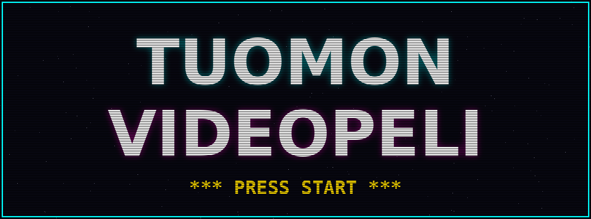
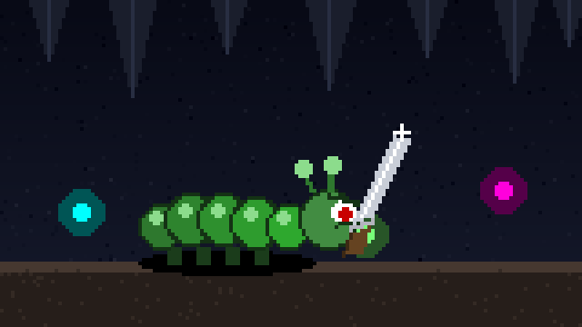
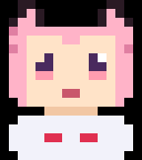

# TUOMON OMA VIDEOPELI



## The hero



Spawned in a dark cave. No armor. No backup. One knife.

## The player model



2D nekomimi femboy, 16x18 pixels, drawn straight onto the canvas — no sprite
sheet, no external assets. Five moods: idle, blink, hurt (sweat drop, open
mouth), dead (X eyes), win (happy eyes). Lives bottom-left in the HUD, goes big
on the title, death and win screens. Fully clothed; the cave stays SFW.

## Sound

SFX are real CC0 clips by Kenney (no attribution required, credited anyway),
embedded in `bridge-runner.html` so the single-file release stays single-file.
Raw files live in `assets/sfx/`. Packs used:

- [RPG Audio](https://kenney.nl/assets/rpg-audio) — knife slices, coins, pot, door
- [Impact Sounds](https://kenney.nl/assets/impact-sounds) — punches, metal, bell
- [Voiceover Pack (Fighter)](https://kenney.nl/assets/voiceover-pack-fighter) — the announcer (FIGHT! FINAL ROUND! YOU WIN!)

Plus synthesized stingers, all Web Audio, zero extra assets: airhorn (win),
vine boom (death), fart (spikes), sad trombone womp womp (death), oof
(enemy punch), bonk (wall bump), honk (loot), boing (dash windup),
record scratch (pause).
Unhinged as requested.
Announcer voice generated locally with Piper en_US-ryan-medium (fight, round_2, round_3, final_round, you_win, game_over, chained, warden_down).
Regen: `echo "Fight!" | piper --model en_US-ryan-medium.onnx --output_file fight.wav` then `ffmpeg -y -i fight.wav -af loudnorm=I=-16:TP=-1.5:LRA=11,aresample=22050 -ar 22050 -c:a libvorbis -q:a 4 fight.ogg`.

Dialogue barks (`assets/voices/`, 202 lines from `assets/voices/lines.tsv`): Kokoro-82M via kokoro-onnx ONNX runtime (no torch), model `kokoro-v1_0.onnx` + `voices.bin` (thewh1teagle/kokoro-onnx model-files-v1.0). 4 speakers: MOTHER=af_sarah @0.95, HERO=bf_alice @1.05, WARDEN=bm_george @0.85, TUHK=am_adam @1.15.
Regen: `python gen_voices.py` (venv `/tmp/opencode/koko/venv`, reads `lines.tsv`, Kokoro 24kHz wav then `ffmpeg -y -i wav -af loudnorm=I=-16:TP=-1.5:LRA=11,aresample=22050 -ar 22050 -c:a libvorbis -q:a 4 ogg`). In-game: `VOICE_COUNTS`/`voice_bank`/`say(cat)` with 5s cooldown.

```
████████╗██╗   ██╗ ██████╗ ███╗   ███╗ ██████╗ ███╗   ██╗
╚══██╔══╝██║   ██║██╔═══██╗████╗ ████║██╔═══██╗████╗  ██║
   ██║   ██║   ██║██║   ██║██╔████╔██║██║   ██║██╔██╗ ██║
   ██║   ██║   ██║██║   ██║██║╚██╔╝██║██║   ██║██║╚██╗██║
   ██║   ╚██████╔╝╚██████╔╝██║ ╚═╝ ██║╚██████╔╝██║ ╚████║
   ╚═╝    ╚═════╝  ╚═════╝ ╚═╝     ╚═╝ ╚═════╝ ╚═╝  ╚═══╝

██╗   ██╗██╗██████╗ ███████╗ ██████╗ ██████╗ ███████╗██╗     ██╗
██║   ██║██║██╔══██╗██╔════╝██╔═══██╗██╔══██╗██╔════╝██║     ██║
██║   ██║██║██║  ██║█████╗  ██║   ██║██████╔╝█████╗  ██║     ██║
╚██╗ ██╔╝██║██║  ██║██╔══╝  ██║   ██║██╔═══╝ ██╔══╝  ██║     ██║
 ╚████╔╝ ██║██████╔╝███████╗╚██████╔╝██║     ███████╗███████╗██║
  ╚═══╝  ╚═╝╚═════╝ ╚══════╝ ╚═════╝ ╚═╝     ╚══════╝╚══════╝╚═╝
```

```
  +----------------------------------------------------------+
  |  LV 01 ..... HP ██████████ 100/100 ..... SCORE 000000     |
  |                                                          |
  |      A long time ago, in a repo far, far away...         |
  |      one dev booted up with nothing but a README         |
  |      and a dream. This is that dream.                    |
  |                                                          |
  |                  >> PRESS START <<                        |
  +----------------------------------------------------------+
```

## The quest

Tuomo's own video game. Born as a single `Hello world!`, destined for
greatness. Plot, engine, sprites, boss fights — all to be forged here.

## Current build: v0.1.0 "femboy edition"

- [x] Repository created
- [x] Insane README art installed
- [x] Game engine (canvas raycaster, single file)
- [x] First playable level
- [x] Boss fight
- [x] Victory screen

## Run it

```sh
git clone https://github.com/taistelupelto-rgb/tuomon-oma-videopeli.git
cd tuomon-oma-videopeli
# single file, zero build, zero deps:
xdg-open bridge-runner.html   # or drag it into a browser
```

## Controls

| Key       | Action              |
|-----------|---------------------|
| `W A S D` | Move / strafe       |
| `← →`     | Turn                |
| `SPACE`   | Slash (hold)        |
| `ENTER`   | Start / new run     |
| `R`       | Reroll the cave     |
| `P`       | Pause               |
| left thumb joystick | Move |
| right thumb drag | Look |
| `KNIFE` (hold) | Slash |
| `EAT` | Use melon/heart |
| `II` | Pause |
| `?` | Codex |
| `NEW` | Restart (when paused) |
| tap | Start |

Touch: left thumb moves, right thumb drag looks. Hold KNIFE to
slash, EAT uses melon/heart, II pauses, tap starts.

```
   GAME OVER? never heard of her.
   (\/) motivation: [██████████] 100%
```

Hello world!
